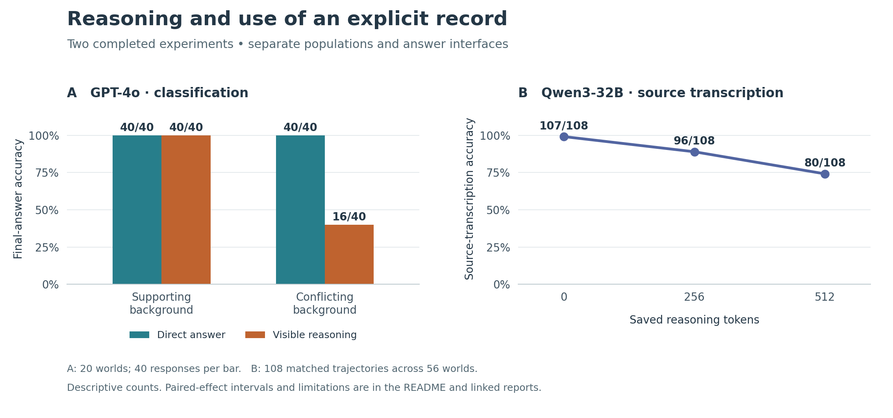

# Reasoning and recorded evidence

Asking for reasoning sometimes makes a language model less likely to follow an explicit record. These experiments examine when that happens, using synthetic vehicle tables in which the target's recorded class can disagree with the pattern in the surrounding rows. The correct answer is known. Background labels can be changed while keeping the target record fixed.

[Results and raw data](results/README.md) · [Experiment status](results/BRANCH_STATUS.md) · [Independent analyses](results/analyses/2026-10-18/README.md)

## GPT-4o

The first test changed the classes of the surrounding vehicles while leaving the target record alone. GPT-4o could either give just the answer or write out its reasoning first. It made mistakes only when asked to reason with a conflicting background.

| Correct answers | Supporting background | Conflicting background |
|---|---:|---:|
| Answer only | 40/40 | 40/40 |
| Reasoning before the answer | 40/40 | 16/40 |

An explicit request for the *recorded* class removed that drop under neutral reasoning in the [wording follow-up](results/reports/wording-001/summary.md). The original question still produced a large drop. The revised question also removed a clause about uncertainty, so either edit, or both together, could account for the difference. The effect did not survive the planned robustness check.

## Mistral

Mistral was asked about the same vehicle in two ways: by its features, or by its license plate. When asked for just the answer, it got all 48 questions right in each version. When asked to write out its reasoning first, it got 20/48 right for the feature descriptions and 33/48 for the license plates.

The attempted control was to have Mistral copy a neutral paragraph before answering. It copied the paragraph exactly in only 60 of 96 responses. That fell short of the protocol's adherence requirement, so the experiment is marked inconclusive in the [report](results/reports/query-form-mistral-001/summary.md).

## Qwen

For Qwen3-32B, the source question came after the reasoning. The experiment took saved responses, kept the first 256 or 512 tokens, and added a new user message asking what was written in the target cell. A third version kept none of the reasoning. The original table remained in the conversation in all three versions.

| Saved reasoning tokens | Correct source reports, same 108 histories |
|---|---:|
| 0 | 107/108 |
| 256 | 96/108 |
| 512 | 80/108 |

At 512 tokens, 27 answers had changed from the correct class to `MISSING`, even though the class was written in the table. All 332 source questions completed with a valid answer format. The table above uses only the 108 histories available at every checkpoint; four others were ineligible at 512 tokens under the original rules.

There is a complication in calling this forgetting. For 21 of those 27 histories, the correct class had the highest score in a separate comparison of A, B and C. That comparison added `ANSWER:` to the assistant's text and scored the candidates; it did not generate an answer to the new user question. The same history could therefore give a false `MISSING` report under one test and favor the recorded class under another. The [independent audit](results/analyses/2026-10-18/Study2_Source_User_Main_Audit.md) examines both readouts.

Longer reasoning also puts more text between the table and the source question and changes where the assistant turn ends. Some prompts mention missing values. These features were not varied separately, so the experiment cannot identify which caused the decline. The runs used greedy decoding with native thinking disabled; Qwen was instructed to write its reasoning in the visible response.



The figure brings together the separate GPT-4o classification and Qwen source-transcription experiments. [Sample sizes, paired estimates and figure sources](docs/research-overview/README.md) · [Download SVG](docs/research-overview/evidence-summary.svg).

## Next experiments

Native thinking has not yet been tested in the archived runs. The planned Qwen comparison uses new controlled worlds and the same sampling settings for thinking on and off. The draft allocates 64 responses to a development pilot and 896 to the main collection. The main token budget will be fixed after reviewing pilot truncation and repetition. Offline shortcut checks are complete; design review and live validation are still pending. Historical greedy responses will remain separate. [Draft protocol](results/branch-artifacts/2026-10-18/context/STUDY2_NATIVE_THINKING_DRAFT_PROTOCOL.md).

A second question is whether changing a specific false claim in the reasoning changes the final answer. This needs independently reviewed passages, an unedited comparator and controls for any answer information introduced by an edit. The intervention proposals are unexecuted, and the whole-history crossing proposal is on hold. [Plans](results/plans/README.md).

Additional support would pay for GPU time and independent annotation for this work. Populations, prompts, scoring and stopping rules would be fixed before the relevant runs, with null and failed outcomes retained alongside positive findings.

## Data and reproduction

Earlier results shaped the follow-up studies. Uncertainty estimates group responses by synthetic world, since each world was used more than once. The text annotations still need independent validation before they can support claims of deliberate overriding. These small studies also cannot settle whether reasoning generally helps or hurts accuracy.

The archive includes the failed Qwen v3 replay check, the unfinished v4 pilot (8/48 originals), and two source-report interfaces that failed calibration before the new-user-turn test. The [results index](results/README.md) links these alongside the completed runs, including invalid and truncated responses. It also identifies exports that overlap. [Branch status](results/BRANCH_STATUS.md) lists unfinished work and the code branches needed to reproduce each experiment.

After cloning the repository, check the saved files with:

```bash
python3 results/verify_results.py
```

[Verification instructions](results/VERIFY.md) explain how to reconstruct split archives. The [historical study guide](STUDY_GUIDE.md) preserves earlier protocols and commands, including live commands that may incur charges.

*The archive check requires Python 3.10 or later. Last archive review: 18 October 2026.*

Related paper: [*Mind Your Step (by Step)*, Liu et al., ICML 2025](https://proceedings.mlr.press/v267/liu25t.html).
