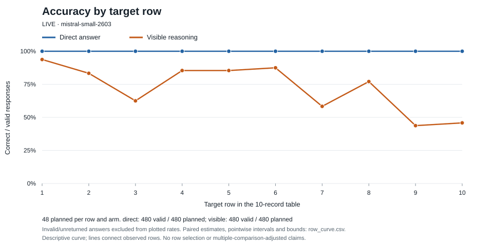

# Target row position: fresh-world confirmation

**LIVE** — mistral-small-2603

Returned 960/960; valid 960; retained invalid 0; attempts 960/1056.
Decision: `confirm_positive_interaction`. Observed direction: `last_more_harm`.

Primary: accuracy interaction (direct − visible at row 10) − (direct − visible at row 1). Positive values mean more reasoning harm at the last row. Each world averages both recorded-label variants; the endpoint interaction requires its eight endpoint responses, not the intermediate-row responses.

This confirmation uses 24 fresh worlds and all ten target positions. The single primary contrast was selected before this collection. It does not establish a retrieval mechanism, model-wide generality, or equivalence. No decision automatically runs further calls. smaller_than_target describes the frozen practical threshold, not proof of no position effect.

Intervals are descriptive 95% percentile intervals from 10,000 whole-world resamples (seed 981723). Sign tests describe sign balance among nonzero world contrasts, not mean magnitude, and never gate spending. Full-plan bounds hold valid answers fixed and range missing/invalid answers over all three labels; they are not confidence intervals. A degenerate bootstrap interval cannot calibrate precision: a large uniform observed effect can meet the directional decision rule, but the interval does not establish population precision. A zero or small degenerate effect cannot trigger smaller_than_target.

The row curve and all secondary intervals are pointwise and unadjusted; they do not identify an optimal row or support ten separate confirmatory tests. Prespecified shape contrasts are H2 − H1, H10 − H9, and (H5 + H6)/2 − (H1 + H10)/2, where Hr is direct-minus-visible accuracy.

row_curve.csv retains valid and planned denominators, paired-world cell estimates, pointwise intervals and full-plan bounds; the plotted rates use valid answers only.

## Per-cell results

| Row / arm | Correct / valid / planned | Wrong: pattern / other | Invalid / unreturned | Manipulation adherence / planned | Median words / tokens |
|---|---:|---:|---:|---:|---:|
| 1/direct | 48 / 48 / 48 | 0 / 0 | 0 / 0 | 48 / 48 | 0.000 / 6.000 |
| 1/visible | 45 / 48 / 48 | 3 / 0 | 0 / 0 | 48 / 48 | 109.000 / 166.000 |
| 2/direct | 48 / 48 / 48 | 0 / 0 | 0 / 0 | 48 / 48 | 0.000 / 6.000 |
| 2/visible | 40 / 48 / 48 | 8 / 0 | 0 / 0 | 48 / 48 | 160.000 / 262.500 |
| 3/direct | 48 / 48 / 48 | 0 / 0 | 0 / 0 | 48 / 48 | 0.000 / 6.000 |
| 3/visible | 30 / 48 / 48 | 18 / 0 | 0 / 0 | 48 / 48 | 207.500 / 350.000 |
| 4/direct | 48 / 48 / 48 | 0 / 0 | 0 / 0 | 48 / 48 | 0.000 / 6.000 |
| 4/visible | 41 / 48 / 48 | 5 / 2 | 0 / 0 | 48 / 48 | 170.500 / 284.500 |
| 5/direct | 48 / 48 / 48 | 0 / 0 | 0 / 0 | 48 / 48 | 0.000 / 6.000 |
| 5/visible | 41 / 48 / 48 | 6 / 1 | 0 / 0 | 48 / 48 | 183.000 / 299.500 |
| 6/direct | 48 / 48 / 48 | 0 / 0 | 0 / 0 | 48 / 48 | 0.000 / 6.000 |
| 6/visible | 42 / 48 / 48 | 4 / 2 | 0 / 0 | 48 / 48 | 179.500 / 294.500 |
| 7/direct | 48 / 48 / 48 | 0 / 0 | 0 / 0 | 48 / 48 | 0.000 / 6.000 |
| 7/visible | 28 / 48 / 48 | 19 / 1 | 0 / 0 | 48 / 48 | 209.500 / 361.500 |
| 8/direct | 48 / 48 / 48 | 0 / 0 | 0 / 0 | 48 / 48 | 0.000 / 6.000 |
| 8/visible | 37 / 48 / 48 | 10 / 1 | 0 / 0 | 48 / 48 | 203.000 / 331.000 |
| 9/direct | 48 / 48 / 48 | 0 / 0 | 0 / 0 | 48 / 48 | 0.000 / 6.000 |
| 9/visible | 21 / 48 / 48 | 26 / 1 | 0 / 0 | 48 / 48 | 230.500 / 377.500 |
| 10/direct | 48 / 48 / 48 | 0 / 0 | 0 / 0 | 48 / 48 | 0.000 / 6.000 |
| 10/visible | 22 / 48 / 48 | 23 / 3 | 0 / 0 | 48 / 48 | 288.000 / 491.000 |

## accuracy

| Estimand | Mean | 95% interval | Complete worlds | Sign p | + / − / ties | Full-plan bounds |
|---|---:|---|---:|---:|---|---|
| 1/direct | 1.000 | 1.000, 1.000 | 24 | 0.000 | 24 / 0 / 0 | 1.000, 1.000 |
| 1/visible | 0.938 | 0.854, 1.000 | 24 | 0.000 | 24 / 0 / 0 | 0.938, 0.938 |
| 2/direct | 1.000 | 1.000, 1.000 | 24 | 0.000 | 24 / 0 / 0 | 1.000, 1.000 |
| 2/visible | 0.833 | 0.688, 0.938 | 24 | 0.000 | 22 / 0 / 2 | 0.833, 0.833 |
| 3/direct | 1.000 | 1.000, 1.000 | 24 | 0.000 | 24 / 0 / 0 | 1.000, 1.000 |
| 3/visible | 0.625 | 0.458, 0.771 | 24 | 0.000 | 19 / 0 / 5 | 0.625, 0.625 |
| 4/direct | 1.000 | 1.000, 1.000 | 24 | 0.000 | 24 / 0 / 0 | 1.000, 1.000 |
| 4/visible | 0.854 | 0.771, 0.938 | 24 | 0.000 | 24 / 0 / 0 | 0.854, 0.854 |
| 5/direct | 1.000 | 1.000, 1.000 | 24 | 0.000 | 24 / 0 / 0 | 1.000, 1.000 |
| 5/visible | 0.854 | 0.750, 0.938 | 24 | 0.000 | 24 / 0 / 0 | 0.854, 0.854 |
| 6/direct | 1.000 | 1.000, 1.000 | 24 | 0.000 | 24 / 0 / 0 | 1.000, 1.000 |
| 6/visible | 0.875 | 0.771, 0.958 | 24 | 0.000 | 23 / 0 / 1 | 0.875, 0.875 |
| 7/direct | 1.000 | 1.000, 1.000 | 24 | 0.000 | 24 / 0 / 0 | 1.000, 1.000 |
| 7/visible | 0.583 | 0.438, 0.708 | 24 | 0.000 | 20 / 0 / 4 | 0.583, 0.583 |
| 8/direct | 1.000 | 1.000, 1.000 | 24 | 0.000 | 24 / 0 / 0 | 1.000, 1.000 |
| 8/visible | 0.771 | 0.646, 0.875 | 24 | 0.000 | 23 / 0 / 1 | 0.771, 0.771 |
| 9/direct | 1.000 | 1.000, 1.000 | 24 | 0.000 | 24 / 0 / 0 | 1.000, 1.000 |
| 9/visible | 0.438 | 0.312, 0.562 | 24 | 0.000 | 18 / 0 / 6 | 0.438, 0.438 |
| 10/direct | 1.000 | 1.000, 1.000 | 24 | 0.000 | 24 / 0 / 0 | 1.000, 1.000 |
| 10/visible | 0.458 | 0.292, 0.625 | 24 | 0.000 | 15 / 0 / 9 | 0.458, 0.458 |
| 1_direct_minus_visible | 0.062 | 0.000, 0.146 | 24 | 0.250 | 3 / 0 / 21 | 0.062, 0.062 |
| 2_direct_minus_visible | 0.167 | 0.062, 0.312 | 24 | 0.031 | 6 / 0 / 18 | 0.167, 0.167 |
| 3_direct_minus_visible | 0.375 | 0.229, 0.542 | 24 | 0.000 | 13 / 0 / 11 | 0.375, 0.375 |
| 4_direct_minus_visible | 0.146 | 0.062, 0.229 | 24 | 0.016 | 7 / 0 / 17 | 0.146, 0.146 |
| 5_direct_minus_visible | 0.146 | 0.062, 0.250 | 24 | 0.016 | 7 / 0 / 17 | 0.146, 0.146 |
| 6_direct_minus_visible | 0.125 | 0.042, 0.229 | 24 | 0.062 | 5 / 0 / 19 | 0.125, 0.125 |
| 7_direct_minus_visible | 0.417 | 0.292, 0.562 | 24 | 0.000 | 16 / 0 / 8 | 0.417, 0.417 |
| 8_direct_minus_visible | 0.229 | 0.125, 0.354 | 24 | 0.002 | 10 / 0 / 14 | 0.229, 0.229 |
| 9_direct_minus_visible | 0.562 | 0.438, 0.688 | 24 | 0.000 | 21 / 0 / 3 | 0.562, 0.562 |
| 10_direct_minus_visible | 0.542 | 0.375, 0.708 | 24 | 0.000 | 17 / 0 / 7 | 0.542, 0.542 |
| direct_last_minus_first | 0.000 | 0.000, 0.000 | 24 | 1.000 | 0 / 0 / 24 | 0.000, 0.000 |
| visible_last_minus_first | -0.479 | -0.625, -0.312 | 24 | 0.000 | 0 / 16 / 8 | -0.479, -0.479 |
| first_boundary_harm_2_minus_1 | 0.104 | 0.000, 0.229 | 24 | 0.219 | 5 / 1 / 18 | 0.104, 0.104 |
| last_boundary_harm_10_minus_9 | -0.021 | -0.229, 0.167 | 24 | 1.000 | 8 / 9 / 7 | -0.021, -0.021 |
| middle_harm_minus_endpoint_average | -0.167 | -0.260, -0.073 | 24 | 0.007 | 2 / 13 / 9 | -0.167, -0.167 |
| interaction | 0.479 | 0.312, 0.625 | 24 | 0.000 | 16 / 0 / 8 | 0.479, 0.479 |

## record_sensitivity

| Estimand | Mean | 95% interval | Complete worlds | Sign p | + / − / ties | Full-plan bounds |
|---|---:|---|---:|---:|---|---|
| 1/direct | 1.000 | 1.000, 1.000 | 24 | 0.000 | 24 / 0 / 0 | 1.000, 1.000 |
| 1/visible | 0.938 | 0.854, 1.000 | 24 | 0.000 | 24 / 0 / 0 | 0.938, 0.938 |
| 2/direct | 1.000 | 1.000, 1.000 | 24 | 0.000 | 24 / 0 / 0 | 1.000, 1.000 |
| 2/visible | 0.833 | 0.688, 0.938 | 24 | 0.000 | 22 / 0 / 2 | 0.833, 0.833 |
| 3/direct | 1.000 | 1.000, 1.000 | 24 | 0.000 | 24 / 0 / 0 | 1.000, 1.000 |
| 3/visible | 0.625 | 0.458, 0.771 | 24 | 0.000 | 19 / 0 / 5 | 0.625, 0.625 |
| 4/direct | 1.000 | 1.000, 1.000 | 24 | 0.000 | 24 / 0 / 0 | 1.000, 1.000 |
| 4/visible | 0.812 | 0.688, 0.917 | 24 | 0.000 | 22 / 0 / 2 | 0.812, 0.812 |
| 5/direct | 1.000 | 1.000, 1.000 | 24 | 0.000 | 24 / 0 / 0 | 1.000, 1.000 |
| 5/visible | 0.833 | 0.708, 0.938 | 24 | 0.000 | 23 / 0 / 1 | 0.833, 0.833 |
| 6/direct | 1.000 | 1.000, 1.000 | 24 | 0.000 | 24 / 0 / 0 | 1.000, 1.000 |
| 6/visible | 0.833 | 0.667, 0.958 | 24 | 0.000 | 22 / 1 / 1 | 0.833, 0.833 |
| 7/direct | 1.000 | 1.000, 1.000 | 24 | 0.000 | 24 / 0 / 0 | 1.000, 1.000 |
| 7/visible | 0.562 | 0.417, 0.708 | 24 | 0.000 | 19 / 0 / 5 | 0.562, 0.562 |
| 8/direct | 1.000 | 1.000, 1.000 | 24 | 0.000 | 24 / 0 / 0 | 1.000, 1.000 |
| 8/visible | 0.750 | 0.625, 0.875 | 24 | 0.000 | 22 / 0 / 2 | 0.750, 0.750 |
| 9/direct | 1.000 | 1.000, 1.000 | 24 | 0.000 | 24 / 0 / 0 | 1.000, 1.000 |
| 9/visible | 0.417 | 0.292, 0.542 | 24 | 0.000 | 17 / 0 / 7 | 0.417, 0.417 |
| 10/direct | 1.000 | 1.000, 1.000 | 24 | 0.000 | 24 / 0 / 0 | 1.000, 1.000 |
| 10/visible | 0.396 | 0.208, 0.583 | 24 | 0.004 | 14 / 2 / 8 | 0.396, 0.396 |
| 1_direct_minus_visible | 0.062 | 0.000, 0.146 | 24 | 0.250 | 3 / 0 / 21 | 0.062, 0.062 |
| 2_direct_minus_visible | 0.167 | 0.062, 0.312 | 24 | 0.031 | 6 / 0 / 18 | 0.167, 0.167 |
| 3_direct_minus_visible | 0.375 | 0.229, 0.542 | 24 | 0.000 | 13 / 0 / 11 | 0.375, 0.375 |
| 4_direct_minus_visible | 0.188 | 0.083, 0.312 | 24 | 0.016 | 7 / 0 / 17 | 0.188, 0.188 |
| 5_direct_minus_visible | 0.167 | 0.062, 0.292 | 24 | 0.016 | 7 / 0 / 17 | 0.167, 0.167 |
| 6_direct_minus_visible | 0.167 | 0.042, 0.333 | 24 | 0.062 | 5 / 0 / 19 | 0.167, 0.167 |
| 7_direct_minus_visible | 0.438 | 0.292, 0.583 | 24 | 0.000 | 16 / 0 / 8 | 0.438, 0.438 |
| 8_direct_minus_visible | 0.250 | 0.125, 0.375 | 24 | 0.002 | 10 / 0 / 14 | 0.250, 0.250 |
| 9_direct_minus_visible | 0.583 | 0.458, 0.708 | 24 | 0.000 | 21 / 0 / 3 | 0.583, 0.583 |
| 10_direct_minus_visible | 0.604 | 0.417, 0.792 | 24 | 0.000 | 17 / 0 / 7 | 0.604, 0.604 |
| direct_last_minus_first | 0.000 | 0.000, 0.000 | 24 | 1.000 | 0 / 0 / 24 | 0.000, 0.000 |
| visible_last_minus_first | -0.542 | -0.729, -0.354 | 24 | 0.000 | 0 / 16 / 8 | -0.542, -0.542 |
| first_boundary_harm_2_minus_1 | 0.104 | 0.000, 0.229 | 24 | 0.219 | 5 / 1 / 18 | 0.104, 0.104 |
| last_boundary_harm_10_minus_9 | 0.021 | -0.188, 0.229 | 24 | 1.000 | 9 / 9 / 6 | 0.021, 0.021 |
| middle_harm_minus_endpoint_average | -0.167 | -0.271, -0.062 | 24 | 0.013 | 2 / 12 / 10 | -0.167, -0.167 |
| interaction | 0.542 | 0.354, 0.729 | 24 | 0.000 | 16 / 0 / 8 | 0.542, 0.542 |

Secondary record sensitivity averages +1 (correct target label), −1 (other target label), 0 (pattern label), over both variants. Its range is [−1, 1]; it does not enter the primary scientific decision.

Controls count every planned response in their denominators: direct requires answer-only output; visible requires pre-answer text. Noncompliance is retained in all scorable-answer estimates. Written text need not reflect hidden computation. Missing answers remain unknown in paired estimates.
